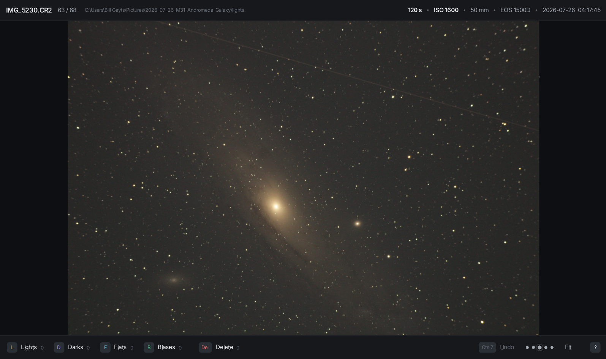

# QuickRAW

A small (~5MB) and fast viewer for Canon RAW photos, written in modern Fortran.

I wanted a simple program to review the RAW astrophotos I took, before stacking them.
I found [RAWviewer](https://github.com/markyip/RAWviewer), but it does not run on GNU/Linux and I could not build it successfully on my system, so I
decided to write my own. QuickRAW allows you to review the photos, see details about them, delete the ones that are bad and quickly arrange them into the folders [Siril](https://siril.org/) expects for the stacking script: lights, darks, flats, biases.

It runs on **GNU/Linux, Windows and macOS**.



## Download and run

See the [Releases](https://github.com/starkaiser/quickraw/releases) page.

Open photos by dropping a photo or a folder on the window, by pressing **O**,
or from the command line:

```
quickraw IMG_0001.CR2        # this photo, browse its folder
quickraw /path/to/session    # a folder
quickraw -v ...              # log decoding and cache activity
```

The macOS app is ad-hoc signed, not notarized. The first time, right-click it
and choose **Open**. On macOS 15 you may instead need *System Settings → Privacy
& Security → Open Anyway*. The app needs the macOS version it was built on, or
a newer one.


## Build from source

Two backends are available: threads and coarrays.

OpenMP threads are used for building the release versions. Coarrays are used on GNU/Linux for development, experimentation and fun!

raylib is compiled from `lib/raylib-6.0` with JPEG support switched on
(raylib's default `config.h` leaves it off). fortran-raylib is compiled from
`lib/fortran-raylib`. Both are built into `build/`, separately for each OS. If
`lib/` is missing them, `packaging/fetch-deps.sh` downloads the pinned versions.

**GNU/Linux** (Debian / Ubuntu / Mint):

```
sudo apt install gfortran gcc make pkg-config libraw-dev \
     libx11-dev libxrandr-dev libxinerama-dev libxcursor-dev libxi-dev libgl1-mesa-dev
make -j4                       # thread backend
make -j4 BACKEND=coarray       # coarray backend (needs OpenCoarrays)
```

**macOS** (Homebrew):

 `brew install gcc libraw pkg-config`, then `make -j4 CC=clang`.

**Windows** ([MSYS2](https://www.msys2.org), *UCRT64* shell):

```
pacman -S make git mingw-w64-ucrt-x86_64-{gcc,gcc-fortran,pkgconf,libraw,lcms2,libjpeg-turbo,zlib}
make -j4
```

Other options: `make help`, `make RELEASE=1`, `make RAYLIB=system` (link an
installed raylib, which must have JPEG support), and `QUICKRAW_WORKERS=n`
(number of decode threads; the default is CPU cores − 1, from 1 to 4).

## License

QuickRAW is BSD 3-Clause licensed. 

Bundled components are licensed under their respective licenses, see `THIRD_PARTY_LICENSES.md` for details.
